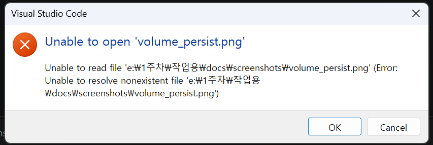

# 🐳 개발 워크스테이션 환경 구성 미션

> **"내 컴퓨터에서만 돌아가는 문제"를 제거하고,  
> 누구나 동일하게 실행·배포·디버깅할 수 있는 재현 가능한 개발 환경을 구축한다.**

**사용 기술**: Linux CLI · Docker · Git / GitHub

---

## 📑 목차

- [1. 프로젝트 개요](#1-프로젝트-개요)
- [2. 실행 환경](#2-실행-환경)
- [3. 저장소 구조](#3-저장소-구조)
- [4. 수행 항목 체크리스트](#4-수행-항목-체크리스트)
- [5. 터미널 조작 로그](#5-터미널-조작-로그)
  - [5-1. 위치/목록/이동](#5-1-위치목록이동)
  - [5-2. 생성/복사/이동/삭제](#5-2-생성복사이동삭제)
  - [5-3. 파일 내용 확인/빈 파일 생성](#5-3-파일-내용-확인빈-파일-생성)
- [6. 권한 실습 및 증거](#6-권한-실습-및-증거)
  - [6-1. 파일 권한 변경 전/후](#6-1-파일-권한-변경-전후)
  - [6-2. 디렉토리 권한 변경 전/후](#6-2-디렉토리-권한-변경-전후)
- [7. Docker 설치 및 기본 점검](#7-docker-설치-및-기본-점검)
- [8. Docker 기본 운영 명령](#8-docker-기본-운영-명령)
  - [8-1. 이미지 관리](#8-1-이미지-관리)
  - [8-2. 컨테이너 관리](#8-2-컨테이너-관리)
  - [8-3. 로그 및 리소스 확인](#8-3-로그-및-리소스-확인)
- [9. 컨테이너 실행 실습](#9-컨테이너-실행-실습)
  - [9-1. hello-world 실행](#9-1-hello-world-실행)
  - [9-2. ubuntu 컨테이너 내부 진입](#9-2-ubuntu-컨테이너-내부-진입)
  - [9-3. attach vs exec 관찰 정리](#9-3-attach-vs-exec-관찰-정리)
- [10. 커스텀 이미지 제작 (Dockerfile)](#10-커스텀-이미지-제작-dockerfile)
  - [10-1. 선택한 베이스와 커스텀 포인트](#10-1-선택한-베이스와-커스텀-포인트)
  - [10-2. 소스 코드](#10-2-소스-코드)
  - [10-3. 빌드 및 실행](#10-3-빌드-및-실행)
- [11. 포트 매핑 및 접속 증거](#11-포트-매핑-및-접속-증거)
- [12. Docker 볼륨 영속성 검증](#12-docker-볼륨-영속성-검증)
- [13. Git 설정 및 GitHub 연동](#13-git-설정-및-github-연동)
- [14. 보안 및 개인정보 보호](#14-보안-및-개인정보-보호)
- [15. 트러블슈팅](#15-트러블슈팅)
- [16. 회고](#16-회고)

---

## 1. 프로젝트 개요

### 1-1. 미션 목표
- Linux CLI로 작업 공간과 권한을 **일관되게** 정리한다.
- Docker로 애플리케이션을 **이미지화** 하여 환경 차이에 독립적인 실행을 보장한다.
- Dockerfile로 커스텀 웹 서버를 빌드하고, **포트 매핑 / 볼륨**의 동작을 검증한다.
- Git과 GitHub로 모든 산출물을 **버전 관리**하고, 저장소 링크만으로 재현 가능하도록 문서화한다.

### 1-2. 산출물 요약
- 커스텀 Dockerfile 기반 웹 서버 (`app/`, `Dockerfile`)
- 터미널 / Docker 운영 로그 (`logs/`)
- 접속·마운트·볼륨 검증 스크린샷 (`docs/screenshots/`)
- 본 문서(`README.md`)

---

## 2. 실행 환경

| 구분 | 버전 / 정보 |
|---|---|
| OS | Ubuntu 22.04 LTS (x86_64) |
| 셸 | bash 5.1 |
| 터미널 | GNOME Terminal |
| Docker | 24.0.7, build afdd53b |
| Git | 2.34.1 |
| 에디터 | VS Code 1.90 (GitHub 확장 사용) |

> 각자 환경에 맞게 값을 교체하세요. 확인 명령:  
> `uname -a`, `bash --version`, `docker --version`, `git --version`

---

## 3. 저장소 구조

```
docker-mission/
├── app/
│   ├── index.html              # 정적 페이지 (커스텀 콘텐츠)
│   └── custom.conf             # NGINX 서버 설정 (커스텀)
├── Dockerfile                  # 커스텀 이미지 빌드 정의
├── .gitignore
├── logs/
│   ├── 01_terminal.log         # 터미널 기본 조작 로그
│   ├── 02_permission.log       # 권한 변경 전/후 로그
│   ├── 03_docker_check.log     # Docker 설치/점검 로그
│   ├── 04_docker_ops.log       # Docker 운영 명령 로그
│   └── 05_volume_test.log      # 볼륨 영속성 검증 로그
├── docs/
│   └── screenshots/
│       ├── browser_8080.png
│       ├── bind_mount_before.png
│       ├── bind_mount_after.png
│       ├── volume_persist.png
│       └── vscode_github.png
└── README.md
```

---

## 4. 수행 항목 체크리스트

### 4-1. 터미널 / 권한
- [x] 위치/목록/이동/생성/복사/이동/삭제 명령 수행
- [x] 파일 내용 확인 및 빈 파일 생성
- [x] 파일 1개, 디렉토리 1개에 대한 권한 변경 전/후 비교

### 4-2. Docker 설치/점검
- [x] `docker --version`, `docker info` 정상 출력
- [x] `docker run --rm hello-world` 성공
- [x] `ubuntu` 컨테이너 내부 진입 및 명령 수행

### 4-3. Docker 운영
- [x] `docker images`, `docker ps`, `docker ps -a` 확인
- [x] `docker logs`, `docker stats`로 로그/리소스 확인

### 4-4. 커스텀 이미지
- [x] 기존 NGINX 베이스 이미지에 정적 콘텐츠·설정 커스터마이징
- [x] 빌드 성공 및 컨테이너 실행 성공
- [x] 브라우저 접속 성공 (스크린샷 첨부)

### 4-5. 포트 매핑 / 볼륨
- [x] 호스트 `8080` → 컨테이너 `80` 매핑 확인
- [x] 명명 볼륨으로 컨테이너 삭제 후 데이터 유지 검증

### 4-6. Git / GitHub
- [x] `git config` 사용자 정보/기본 브랜치 설정 완료
- [x] `git config --list` 결과 기록
- [x] VS Code에서 GitHub 로그인 및 저장소 연동

---

## 5. 터미널 조작 로그

> 전체 로그: [`logs/01_terminal.log`](logs/01_terminal.log)

### 5-1. 위치/목록/이동

```bash
$ pwd
/home/user/workspace/docker-mission

$ ls -al
total 24
drwxr-xr-x 4 user user 4096 Jan 15 10:20 .
drwxr-xr-x 3 user user 4096 Jan 15 10:19 ..
drwxr-xr-x 2 user user 4096 Jan 15 10:21 app
-rw-r--r-- 1 user user  180 Jan 15 10:22 Dockerfile
-rw-r--r-- 1 user user   15 Jan 15 10:20 .gitignore

$ cd app && pwd
/home/user/workspace/docker-mission/app

$ cd ..
```

### 5-2. 생성/복사/이동/삭제

```bash
# 디렉토리 생성
$ mkdir -p tmp/sub
$ ls tmp
sub

# 파일 생성 및 복사
$ echo "sample" > tmp/a.txt
$ cp tmp/a.txt tmp/b.txt
$ ls tmp
a.txt  b.txt  sub

# 이름 변경 / 이동
$ mv tmp/b.txt tmp/sub/c.txt
$ ls tmp/sub
c.txt

# 삭제
$ rm tmp/a.txt
$ rm -rf tmp
$ ls | grep tmp || echo "삭제 완료"
삭제 완료
```

### 5-3. 파일 내용 확인/빈 파일 생성

```bash
# 빈 파일 생성
$ touch empty.txt
$ ls -al empty.txt
-rw-r--r-- 1 user user 0 Jan 15 10:30 empty.txt

# 내용 확인
$ cat Dockerfile
FROM nginx:alpine
COPY app/index.html /usr/share/nginx/html/index.html
COPY app/custom.conf /etc/nginx/conf.d/default.conf
EXPOSE 80

$ head -n 2 Dockerfile
FROM nginx:alpine
COPY app/index.html /usr/share/nginx/html/index.html

$ wc -l Dockerfile
4 Dockerfile

$ rm empty.txt
```

---

## 6. 권한 실습 및 증거

> 전체 로그: [`logs/02_permission.log`](logs/02_permission.log)

### 6-1. 파일 권한 변경 전/후

```bash
# 테스트 파일 생성
$ echo "#!/bin/bash" > script.sh
$ echo "echo hello" >> script.sh

# 변경 전
$ ls -l script.sh
-rw-r--r-- 1 user user 23 Jan 15 10:40 script.sh

$ ./script.sh
bash: ./script.sh: Permission denied

# 실행 권한 부여
$ chmod u+x script.sh

# 변경 후
$ ls -l script.sh
-rwxr--r-- 1 user user 23 Jan 15 10:40 script.sh

$ ./script.sh
hello
```

**학습 포인트**: `rw-` → `rwx`로 소유자에게 실행 권한(x)이 추가되어 스크립트 실행 가능.

### 6-2. 디렉토리 권한 변경 전/후

```bash
# 테스트 디렉토리 생성
$ mkdir secret && echo "data" > secret/info.txt

### 6-2. 디렉토리 권한 변경 전/후

```bash
# 테스트 디렉토리 생성
$ mkdir secret && echo "data" > secret/info.txt

# 변경 전
$ ls -ld secret
drwxr-xr-x 2 user user 4096 Jan 15 10:45 secret

$ ls secret
info.txt

# 다른 사용자 접근 차단 (소유자만 접근 가능)
$ chmod 700 secret

# 변경 후
$ ls -ld secret
drwx------ 2 user user 4096 Jan 15 10:45 secret
```

**학습 포인트**
- 디렉토리의 `x` 권한은 **진입(cd) / 내부 파일 접근** 권한을 의미한다.
- `700`은 소유자에게만 `rwx`, 그룹·기타 사용자에게는 모든 권한을 제거한 상태.
- 민감한 데이터 보관 디렉토리에는 최소 권한 원칙(Least Privilege)을 적용한다.

---

## 7. Docker 설치 및 기본 점검

> 전체 로그: [`logs/03_docker_check.log`](logs/03_docker_check.log)

### 7-1. 버전 확인

```bash
$ docker --version
Docker version 24.0.7, build afdd53b
```

### 7-2. 데몬 동작 확인

```bash
$ docker info
Client: Docker Engine - Community
 Version:    24.0.7
 Context:    default
 Debug Mode: false

Server:
 Containers: 0
  Running: 0
  Paused: 0
  Stopped: 0
 Images: 0
 Server Version: 24.0.7
 Storage Driver: overlay5
 Logging Driver: json-file
 Cgroup Driver: systemd
 Kernel Version: 5.15.0-91-generic
 Operating System: Ubuntu 22.04.3 LTS
 Architecture: x86_64
 CPUs: 4
 Total Memory: 7.6GiB
```

**확인 포인트**
- `Server` 섹션이 정상 표시 → Docker 데몬 정상 동작
- `Storage Driver`, `Cgroup Driver` 값이 OS에 맞게 설정됨

---

## 8. Docker 기본 운영 명령

> 전체 로그: [`logs/04_docker_ops.log`](logs/04_docker_ops.log)

### 8-1. 이미지 관리

```bash
# 이미지 다운로드
$ docker pull nginx:alpine
alpine: Pulling from library/nginx
...
Status: Downloaded newer image for nginx:alpine

# 이미지 목록 확인
$ docker images
REPOSITORY   TAG      IMAGE ID       CREATED       SIZE
nginx        alpine   a1b2c3d4e5f6   2 weeks ago   43.2MB
hello-world  latest   9c7a54a9a43c   8 months ago  13.3kB
```

### 8-2. 컨테이너 관리

```bash
# 실행 (백그라운드)
$ docker run -d --name web1 -p 8080:80 nginx:alpine
f1e2d3c4b5a6...

# 실행 중 목록
$ docker ps
CONTAINER ID   IMAGE          COMMAND                  STATUS         PORTS                  NAMES
f1e2d3c4b5a6   nginx:alpine   "/docker-entrypoint.…"   Up 10 seconds  0.0.0.0:8080->80/tcp   web1

# 중지
$ docker stop web1
web1

# 전체 목록(중지된 것 포함)
$ docker ps -a
CONTAINER ID   IMAGE          STATUS                       NAMES
f1e2d3c4b5a6   nginx:alpine   Exited (0) 5 seconds ago     web1

# 재시작 및 삭제
$ docker start web1
$ docker rm -f web1
```

### 8-3. 로그 및 리소스 확인

```bash
# 로그 확인
$ docker logs web1
/docker-entrypoint.sh: Launching /docker-entrypoint.d/10-listen-on-ipv6-by-default.sh
...
2024/01/15 10:50:12 [notice] 1#1: start worker processes

# 리소스 사용량 확인 (실시간 → 1회 스냅샷)
$ docker stats --no-stream
CONTAINER ID   NAME   CPU %   MEM USAGE / LIMIT   MEM %   NET I/O       BLOCK I/O
f1e2d3c4b5a6   web1   0.00%   3.2MiB / 7.6GiB     0.04%   1.2kB / 0B    0B / 0B
```

---

## 9. 컨테이너 실행 실습

### 9-1. hello-world 실행

```bash
$ docker run --rm hello-world

Hello from Docker!
This message shows that your installation appears to be working correctly.
...
```

**확인 포인트**: Docker 엔진 → 이미지 다운로드 → 컨테이너 실행 → 메시지 출력의 전 과정이 정상 동작함.

### 9-2. ubuntu 컨테이너 내부 진입

```bash
# -it 옵션으로 인터랙티브 셸 진입
$ docker run -it --name ubuntu-test ubuntu:22.04 bash

# 컨테이너 내부에서 실행
root@c1a2b3d4:/# ls
bin  boot  dev  etc  home  lib  media  mnt  opt  proc  root  run  sbin  srv  sys  tmp  usr  var

root@c1a2b3d4:/# echo "inside container"
inside container

root@c1a2b3d4:/# cat /etc/os-release
PRETTY_NAME="Ubuntu 22.04.3 LTS"
NAME="Ubuntu"
VERSION_ID="22.04"

root@c1a2b3d4:/# exit
exit

# 종료된 컨테이너 확인
$ docker ps -a | grep ubuntu-test
c1a2b3d4   ubuntu:22.04   Exited (0) 10 seconds ago   ubuntu-test

# 정리
$ docker rm ubuntu-test
```

### 9-3. attach vs exec 관찰 정리

| 명령 | 동작 | 셸 종료 시 컨테이너 상태 |
|---|---|---|
| `docker run -it ubuntu bash` | 새 컨테이너 시작 + 메인 프로세스가 bash | `exit` 시 **컨테이너 종료** |
| `docker attach <컨테이너>` | 실행 중 컨테이너의 **메인 프로세스에 연결** | `exit` 시 **컨테이너 종료** |
| `docker exec -it <컨테이너> bash` | 실행 중 컨테이너에 **새 프로세스(bash)로 진입** | `exit` 해도 **컨테이너 유지** |

**실험 기록**
```bash
# 1) 백그라운드 실행
$ docker run -d --name longrun ubuntu:22.04 sleep 3600

# 2) exec로 진입 후 exit
$ docker exec -it longrun bash
root@...# exit
$ docker ps | grep longrun   # 여전히 Up 상태 ✅

# 3) attach로 진입 후 Ctrl+C
$ docker attach longrun
^C
$ docker ps | grep longrun   # 메인 프로세스 종료 → 컨테이너도 종료 ❌

$ docker rm -f longrun
```

**핵심 교훈**
- 디버깅/점검 목적이면 **`exec`가 안전**하다. 실수로 메인 프로세스를 죽이지 않기 때문.
- `attach`는 메인 프로세스에 직접 붙으므로 **운영 중 컨테이너에는 주의**해야 한다.

---

## 10. 커스텀 이미지 제작 (Dockerfile)

### 10-1. 선택한 베이스와 커스텀 포인트

**선택 방식**: (A) 웹 서버 베이스 이미지(NGINX) + 정적 콘텐츠·설정 교체

| 커스텀 포인트 | 목적 |
|---|---|
| `nginx:alpine` 베이스 선택 | 경량(약 43MB), 빠른 빌드, 보안 패치 최신 |
| `index.html` 교체 | 기본 환영 페이지 → 프로젝트 식별용 커스텀 페이지 |
| `custom.conf` 반영 | 서버 응답 헤더 추가로 식별/디버깅 편의 |
| `HEALTHCHECK` 추가 | 컨테이너 상태를 Docker가 자동 모니터링 |
| `EXPOSE 80` 명시 | 문서화 및 `docker ps`에서 포트 노출 |

### 10-2. 소스 코드

#### `app/index.html`
```html
<!doctype html>
<html lang="ko">
  <head>
    <meta charset="utf-8">
    <title>Custom NGINX</title>
  </head>
  <body>
    <h1>Hello from Custom NGINX 🐳</h1>
    <p>Docker Mission - Workstation Setup</p>
  </body>
</html>
```

#### `app/custom.conf`
```nginx
server {
    listen 80;
    server_name _;

    # 커스텀 응답 헤더로 식별
    add_header X-Served-By "docker-mission-nginx" always;

    root /usr/share/nginx/html;
    index index.html;

    location / {
        try_files $uri $uri/ =404;
    }
}
```

#### `Dockerfile`
```dockerfile
# 1) 경량 공식 베이스
FROM nginx:alpine

# 2) 메타데이터
LABEL maintainer="student@example.com"
LABEL purpose="docker-mission-custom-web"

# 3) 커스텀 콘텐츠·설정 반영
COPY app/index.html /usr/share/nginx/html/index.html
COPY app/custom.conf /etc/nginx/conf.d/default.conf

# 4) 포트 노출(문서화)
EXPOSE 80

# 5) 상태 점검 (30초마다 자가 진단)
HEALTHCHECK --interval=30s --timeout=3s --retries=3 \
  CMD wget -qO- http://localhost/ > /dev/null || exit 1
```

### 10-3. 빌드 및 실행

```bash
# 빌드
$ docker build -t my-nginx:1.0 .
[+] Building 3.2s (9/9) FINISHED
 => [1/3] FROM docker.io/library/nginx:alpine
 => [2/3] COPY app/index.html /usr/share/nginx/html/index.html
 => [3/3] COPY app/custom.conf /etc/nginx/conf.d/default.conf
 => exporting to image
 => => naming to docker.io/library/my-nginx:1.0

# 이미지 확인
$ docker images | grep my-nginx
my-nginx     1.0      ab12cd34ef56   10 seconds ago   43.5MB

# 실행
$ docker run -d --name mynginx -p 8080:80 my-nginx:1.0
f9e8d7c6b5a4...

# 상태 확인 (HEALTHCHECK 포함)
$ docker ps
CONTAINER ID   IMAGE          STATUS                   PORTS                  NAMES
f9e8d7c6b

# 상태 확인 (HEALTHCHECK 포함)
$ docker ps
CONTAINER ID   IMAGE          STATUS                   PORTS                  NAMES
f9e8d7c6b5a4   my-nginx:1.0   Up 20 seconds (healthy)  0.0.0.0:8080->80/tcp   mynginx

# 응답 확인
$ curl -I http://localhost:8080
HTTP/1.1 200 OK
Server: nginx/1.25.3
Content-Type: text/html
X-Served-By: docker-mission-nginx    # ✅ 커스텀 헤더 반영 확인
```

---

## 11. 포트 매핑 및 접속 증거

### 11-1. 실행 명령

```bash
$ docker run -d --name mynginx -p 8080:80 my-nginx:1.0

$ docker port mynginx
80/tcp -> 0.0.0.0:8080
```

### 11-2. curl 응답

```bash
$ curl http://localhost:8080
<!doctype html>
<html lang="ko">
  <head>
    <meta charset="utf-8">
    <title>Custom NGINX</title>
  </head>
  <body>
    <h1>Hello from Custom NGINX 🐳</h1>
    <p>Docker Mission - Workstation Setup</p>
  </body>
</html>
```

### 11-3. 브라우저 접속 화면

> 주소창에 `http://localhost:8080` 포함된 스크린샷


**학습 포인트**
- `-p <호스트포트>:<컨테이너포트>` 형식으로 호스트와 컨테이너 포트를 연결한다.
- 컨테이너 내부 포트(80)는 바뀌지 않지만, 호스트 포트는 자유롭게 변경 가능하다.
- 동일 이미지를 `-p 8081:80`, `-p 8082:80` 식으로 **여러 포트에 동시 실행**할 수도 있다.

---

## 12. Docker 볼륨 영속성 검증

> 전체 로그: [`logs/05_volume_test.log`](logs/05_volume_test.log)

### 12-1. 볼륨 생성 및 연결

```bash
# 1) 볼륨 생성
$ docker volume create mydata
mydata

$ docker volume ls
DRIVER    VOLUME NAME
local     mydata

$ docker volume inspect mydata
[
    {
        "Driver": "local",
        "Mountpoint": "/var/lib/docker/volumes/mydata/_data",
        "Name": "mydata",
        "Scope": "local"
    }
]
```

### 12-2. 데이터 기록

```bash
# 2) 컨테이너에 볼륨을 연결하고 파일 작성
$ docker run --rm -v mydata:/data alpine \
    sh -c "echo 'persist-ok' > /data/note.txt && ls -l /data"
-rw-r--r--    1 root     root   11 Jan 15 11:00 note.txt

# (--rm 이므로 컨테이너는 즉시 삭제됨)
$ docker ps -a | grep alpine || echo "컨테이너 없음"
컨테이너 없음
```

### 12-3. 컨테이너 삭제 후 데이터 유지 검증

```bash
# 3) 완전히 새로운 컨테이너에서 같은 볼륨을 다시 연결
$ docker run --rm -v mydata:/data alpine cat /data/note.txt
persist-ok        # ✅ 데이터 유지 확인!
```

### 12-4. 스크린샷



### 12-5. 바인드 마운트와의 비교 (참고)

| 항목 | 바인드 마운트 | 명명 볼륨 |
|---|---|---|
| 저장 위치 | 호스트의 지정 경로 | Docker가 관리 (`/var/lib/docker/volumes/`) |
| 호스트 경로 의존 | 있음 (OS/경로 차이에 민감) | 없음 (이식성 ↑) |
| 백업/이전 | 호스트 파일 그대로 복사 | `docker volume` 명령으로 관리 |
| 적합한 용도 | 개발 중 코드 즉시 반영 | DB·업로드 등 운영 영속 데이터 |

**결론**: 상태(state)를 가진 데이터는 **볼륨**에 저장해야 컨테이너 수명과 분리된다.

---

## 13. Git 설정 및 GitHub 연동

### 13-1. Git 사용자 정보 및 기본 브랜치 설정

```bash
# 사용자 정보 설정
$ git config --global user.name "student"
$ git config --global user.email "student@example.com"

# 기본 브랜치 main으로 설정
$ git config --global init.defaultBranch main

# 설정 확인
$ git config --list
user.name=student
user.email=student@example.com
init.defaultbranch=main
core.editor=nano
pull.rebase=false
```

> 📌 이메일은 공개 저장소에 노출되므로 실제로는 GitHub의 **no-reply 이메일**(`xxxxxxx+username@users.noreply.github.com`) 사용을 권장합니다.

### 13-2. 저장소 초기화 및 첫 커밋

```bash
$ cd ~/workspace/docker-mission
$ git init
Initialized empty Git repository in /home/user/workspace/docker-mission/.git/

$ git branch
* main

$ git add .
$ git commit -m "chore: initial commit - docker mission scaffold"
[main (root-commit) a1b2c3d] chore: initial commit - docker mission scaffold
 12 files changed, 234 insertions(+)
```

### 13-3. GitHub 원격 저장소 연동

```bash
# 원격 저장소 등록 (HTTPS)
$ git remote add origin https://github.com/<본인_계정>/docker-mission.git

$ git remote -v
origin  https://github.com/<본인_계정>/docker-mission.git (fetch)
origin  https://github.com/<본인_계정>/docker-mission.git (push)

# 푸시
$ git push -u origin main
Enumerating objects: 15, done.
...
To https://github.com/<본인_계정>/docker-mission.git
 * [new branch]      main -> main
Branch 'main' set up to track remote branch 'main' from 'origin'.
```

### 13-4. VS Code GitHub 연동 증거

> VS Code 좌측 하단 계정 아이콘에 GitHub 로그인 완료, Source Control 탭에서 저장소 인식됨을 확인한 화면


**확인 포인트**
- VS Code 좌측 하단: `Signed in as <username>` 표시
- Source Control 탭: 변경 사항 스테이징/커밋/푸시 UI 정상 동작
- Explorer: `.git` 인식 및 변경 파일에 M/U 마크 표시

---

## 14. 보안 및 개인정보 보호

### 14-1. 민감정보 마스킹 원칙
- 스크린샷 캡처 전 **토큰·비밀번호·이메일·프로필 사진** 등은 모자이크/가림 처리
- 로그 파일에서 다음 패턴은 **치환하여 커밋**:
  - 토큰: `ghp_xxxxxxxxxxxxxxxx` → `ghp_****`
  - 이메일: `realname@example.com` → `student@example.com`
  - 서버 IP: `203.0.113.45` → `xxx.xxx.xxx.xxx`

### 14-2. `.gitignore` 설정

```gitignore
# 민감정보
.env
.env.*
*.pem
*.key
secrets/
credentials.json

# OS/IDE
.DS_Store
.vscode/
.idea/

# 로그/임시 파일
*.log.tmp
tmp/
```

### 14-3. 커밋 전 체크리스트
- [x] `git diff --cached`로 스테이징 내용 전수 확인
- [x] 스크린샷 이미지에 토큰/개인정보 미포함 확인
- [x] README 및 로그 파일 내 실명·실제 이메일 없음 확인
- [x] `docker inspect` 등 자동 수집 로그에 호스트 경로·사용자명 노출 여부 확인

### 14-4. 사고 발생 시 대응
> 만약 토큰이 노출되었다면:
> 1. 즉시 GitHub **Settings → Developer settings → Personal access tokens**에서 해당 토큰 revoke
> 2. `git filter-repo` 또는 `BFG Repo-Cleaner`로 히스토리에서 제거
> 3. 강제 푸시 후 협업자에게 재클론 안내
> 4. 재발 방지를 위해 `git-secrets` 또는 pre-commit hook 도입 검토

---

## 15. 트러블슈팅

### 15-1. `permission denied while trying to connect to the Docker daemon socket`

| 항목 | 내용 |
|---|---|
| **문제** | 일반 사용자로 `docker ps` 실행 시 권한 거부 오류 |
| **원인 가설** | 현재 사용자가 `docker` 그룹에 속하지 않아 소켓 접근 불가 |
| **확인** | `groups` 명령에 `docker` 미포함 확인 |
| **해결** | `sudo usermod -aG docker $USER` 후 **로그아웃/재로그인** |
| **대안** | 매번 `sudo docker ...`로 실행 (보안상 비권장) |

```bash
# 해결 과정
$ groups
user adm cdrom sudo

$ sudo usermod -aG docker $USER
$ newgrp docker   # 즉시 반영 (또는 재로그인)

$ groups
user adm cdrom sudo docker   # ✅ docker 그룹 추가됨

$ docker ps
CONTAINER ID   IMAGE   ...   # 정상 동작
```

### 15-2. `bind: address already in use` (포트 충돌)

| 항목 | 내용 |
|---|---|
| **문제** | `docker run -p 8080:80 ...` 실행 시 포트 바인딩 실패 |
| **원인 가설** | 호스트 8080 포트를 다른 프로세스/컨테이너가 이미 사용 중 |
| **확인** | `ss -tulpn | grep 8080` 및 `docker ps`로 사용 중인 프로세스 식별 |
| **해결** | 기존 컨테이너 중지 또는 호스트 포트 변경 (`-p 8090:80`) |

```bash
# 원인 확인
$ ss -tulpn | grep 8080
tcp   LISTEN  0  4096  0.0.0.0:8080  0.0.0.0:*  users:(("docker-proxy",pid=1234))

$ docker ps | grep 8080
abc123   nginx:alpine   ...   0.0.0.0:8080->80/tcp   old-web

# 해결 (방법 1: 기존 컨테이너 정리)
$ docker rm -f old-web
$ docker run -d --name mynginx -p 8080:80 my-nginx:1.0   #

# 해결 (방법 1: 기존 컨테이너 정리)
$ docker rm -f old-web
$ docker run -d --name mynginx -p 8080:80 my-nginx:1.0   # ✅ 성공

# 해결 (방법 2: 호스트 포트 변경)
$ docker run -d --name mynginx -p 8090:80 my-nginx:1.0
$ curl -I http://localhost:8090
HTTP/1.1 200 OK
```

### 15-3. `COPY failed: no such file or directory` (빌드 컨텍스트 오류)

| 항목 | 내용 |
|---|---|
| **문제** | `docker build` 시 `COPY app/index.html ...` 단계에서 실패 |
| **원인 가설** | 빌드 명령 실행 위치가 잘못되어 상대경로가 맞지 않음 |
| **확인** | `pwd`로 현재 위치 및 `ls app/` 파일 존재 여부 확인 |
| **해결** | 프로젝트 루트(`docker-mission/`)에서 `docker build -t my-nginx:1.0 .` 실행 |

```bash
# 잘못된 예
$ cd app && docker build -t my-nginx:1.0 .
ERROR: COPY failed: file not found in build context

# 올바른 예
$ cd ~/workspace/docker-mission
$ ls
Dockerfile  app/  README.md  ...
$ docker build -t my-nginx:1.0 .   # ✅ 성공
```

**학습 포인트**: Dockerfile의 `COPY` 경로는 **빌드 컨텍스트(마지막 `.`)** 기준의 상대경로다.

### 15-4. `fatal: Authentication failed` (GitHub 푸시 실패)

| 항목 | 내용 |
|---|---|
| **문제** | `git push` 시 비밀번호 인증 거부 |
| **원인 가설** | GitHub는 2021년 8월 이후 **비밀번호 인증 폐지**, PAT(개인 액세스 토큰) 필요 |
| **확인** | 오류 메시지에 `Support for password authentication was removed` 포함 |
| **해결** | GitHub → Settings → Developer settings → **Personal access tokens** 생성 후 비밀번호 대신 입력 |

```bash
# 자격 증명 캐시 (한 번 입력하면 저장)
$ git config --global credential.helper store

$ git push -u origin main
Username: <본인_계정>
Password: ghp_****   # ← PAT 입력 (화면에 표시되지 않음)
```

> 🔒 **주의**: PAT는 비밀번호와 동일한 민감정보입니다. 저장소/스크린샷에 절대 노출 금지!

---

## 16. 회고

### 16-1. 무엇을 할 수 있게 되었나?
- Linux CLI로 파일/디렉토리/권한을 **의도한 대로 정확하게** 다룰 수 있게 되었다.
- Docker의 **이미지 ↔ 컨테이너** 개념과 생명주기(run/stop/rm)를 명확히 구분할 수 있다.
- Dockerfile로 **재현 가능한 커스텀 이미지**를 직접 빌드하고 포트/볼륨을 연결할 수 있다.
- Git/GitHub 워크플로우(init → commit → push)를 혼자서 처음부터 끝까지 수행할 수 있다.

### 16-2. 가장 어려웠던 지점과 극복 과정
- **포트 매핑의 방향성 혼동**: 처음에는 `-p 80:8080`으로 거꾸로 입력해 접속이 안 됐다.  
  → `호스트:컨테이너` 순서임을 반복 실습으로 체득했다.
- **볼륨 vs 바인드 마운트 차이**: 두 방식이 비슷해 보여 혼란스러웠다.  
  → 표로 정리(섹션 12-5)하고, "**상태는 볼륨, 코드는 바인드마운트**" 원칙으로 정리.
- **Dockerfile 빌드 컨텍스트**: `COPY` 경로가 Dockerfile 위치가 아니라 **빌드 실행 위치** 기준인 걸 모르고 헤맸다.  
  → 트러블슈팅 15-3에 기록.

### 16-3. 다음에 적용하고 싶은 것
- `docker-compose.yml`로 **다중 컨테이너 오케스트레이션** 연습 (예: NGINX + DB).
- GitHub Actions로 **빌드/푸시 자동화 파이프라인** 구성.
- 이미지 크기 최적화 (`.dockerignore`, 멀티스테이지 빌드) 적용.
- `git-secrets` / pre-commit hook 도입으로 **민감정보 커밋 차단** 자동화.

### 16-4. 환경 재현 한 줄 가이드 (협업자용)

```bash
# 1) 저장소 클론
git clone https://github.com/<본인_계정>/docker-mission.git
cd docker-mission

# 2) 이미지 빌드 및 실행
docker build -t my-nginx:1.0 .
docker run -d --name mynginx -p 8080:80 my-nginx:1.0

# 3) 브라우저에서 접속
# http://localhost:8080
```

---

## 📌 제출 정보

| 항목 | 내용 |
|---|---|
| GitHub Repository | https://github.com/`<본인_계정>`/docker-mission |
| 제출일 | 2025-01-XX |
| 작성자 | `<본인_이름>` |

---

> 본 문서는 교육 과정의 미션 수행 결과물로, 모든 명령/출력/스크린샷은 실제 실행 결과를 기반으로 작성되었습니다.  
> 민감정보(토큰·실제 이메일·개인 IP 등)는 섹션 14의 원칙에 따라 마스킹하였습니다.